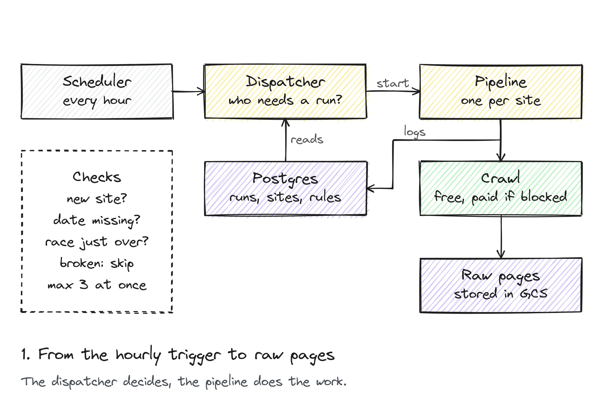
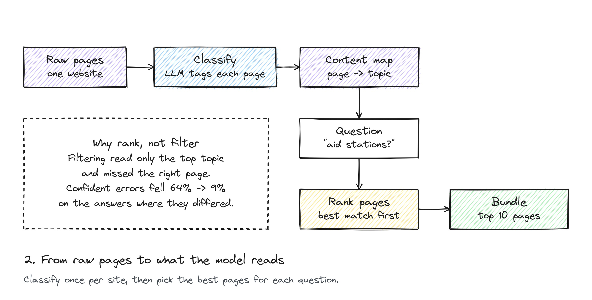
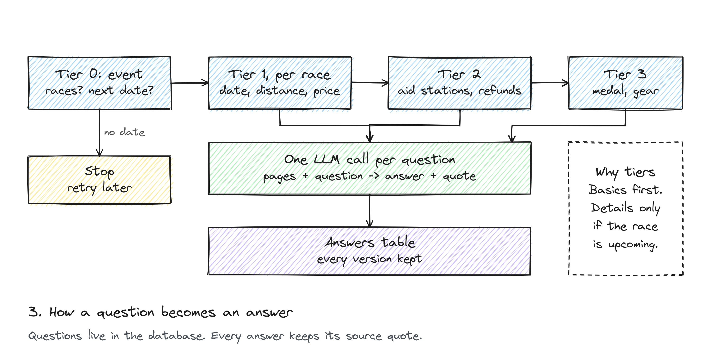

Before registering for a running event, there is a certain level of information you expect to find on a race organizer's website. Is there an upcoming date, what is the cutoff, how many aid stations, is there a lottery, can I get cancel my participation and get a refund. Small race organizers write good websites, but they do not write them for machines, and they do not write them the same way twice.

[indierunners.co](https://indierunners.co) is my attempt to read those pages once, on a schedule, and keep the answers in a table. 
The site itself is a FastAPI app. The interesting part sits behind it: a pipeline that crawls each race website, works out which pages carry which kind of information, and asks a language model one question at a time with the right pages in front of it.

As of this writing the pipeline watches 570 running event websites with 1,724 races between them, and the answers table holds about 56,000 answers. It makes roughly 3,500 model calls a day. This post walks through the three stages, the one test that changed the design, and what went wrong on the way.

### the setup

Everything runs on Google Cloud. A Cloud Scheduler entry fires every hour and starts a dispatcher, which is a Cloud Run job. The dispatcher decides which race websites need a run and launches one pipeline container per target, also as a Cloud Run job. Postgres holds run history, targets, policy settings, the questions and the answers. Raw pages land in Cloud Storage, one file per page, older versions kept.

The crawler is plain Python. A paid crawler, [spider.cloud](https://spider.cloud), only steps in when the free one comes back empty handed (e.g. rendering is needed). Tier 0 questions go to Claude Sonnet 5.5, tier 1 to GPT 5.6 Luna, and tiers 2 and 3 to o4-mini. In the future, the idea is to test different models that could help improving speed and/or accuracy at a similar cost.

### stage 1 -> the dispatcher decides


<font size="-1"><center><span> from the hourly trigger to raw pages in storage </span></center></font>
<br>

The first design rule is that nothing runs without a reason recorded in the database. The dispatcher does not crawl on a fixed schedule per site. It reads the run history and a set of policies, and each policy is a query that returns targets with a reason to run: a new target, an event whose date is missing, an event that just finished, a registration page that has gone stale.

Here is one of them. It picks targets whose last successful run found races but no upcoming date, and re-checks them weekly if anyone on the site follows the event.

```sql
-- Targets whose last successful run found races but no future date,
-- due a re-check: weekly if anyone follows the event, fortnightly if not.
WITH last_success AS (
    SELECT DISTINCT ON (r.target_name)
           r.target_name, r.params, r.started_at
    FROM pipeline.pipeline_runs r
    WHERE r.status = 'success'
    ORDER BY r.target_name, r.started_at DESC
),
interest AS (
    SELECT e.event_slug, count(*) AS followers
    FROM web.attendance a
    JOIN core.events e ON e.id = a.event_id
    WHERE a.status IN ('going', 'interested')
    GROUP BY e.event_slug
)
SELECT t.target_slug, t.active_scraper
FROM race_scraper.website_targets t
JOIN last_success ls ON ls.target_name = t.target_slug
LEFT JOIN interest i ON i.event_slug = t.target_slug
WHERE (ls.params->'upcoming_edition_gate'->>'gate_open') = 'false'
  AND ls.started_at < now() - CASE
          WHEN coalesce(i.followers, 0) > 0
              THEN make_interval(days => %(followed_days)s)    -- 7
          ELSE make_interval(days => %(unfollowed_days)s)      -- 14
      END
ORDER BY coalesce(i.followers, 0) DESC, ls.started_at ASC
```
<script src="https://gist.github.com/moralescastillo/GIST_ID.js"></script>
<font size="-1"><center><span> Dispatcher policy for targets with no upcoming date, from <code>scripts/dispatch_pipelines.py</code> </span></center></font>
<br>

The query only lists candidates. Before anything launches, the dispatcher applies the rules shared by every policy: skip targets in quarantine (sites that keep breaking), skip during a known outage, skip targets that are still running or switched off, and keep roughly three pipelines going at once. The 7 and 14 days come from a `policy_config` table, so changing them does not need a deploy.

The median run takes 6 minutes, p90 was 15 minutes, p99 was 27 minutes and the longest 29. A small, healthy site is about 11 pages and crawls in 27 seconds. Larger sites run to about 40 pages. The median page has about 870 words.

### stage 2 -> from pages to a bundle


<font size="-1"><center><span> from raw pages to the content a question is answered from </span></center></font>
<br>

A race website is small enough to classify once per crawl. A model reads the first 500 words of every page and labels it: registration, course, pricing, results, services, and so on. The result is a content map for the site.

When a question arrives, it knows which categories matter to it. The matching pages are ranked, most relevant first, then by whether they belong to the right race, then by freshness. The top ten pages become the bundle, and the bundle is all the model gets to answer that one question.

That is the current design. The first version did something that sounded reasonable and was not.

### rethinking stage 2

The first version treated relevance as a gate. It looked for pages in the question's best category, and if it found even one, it never looked at the next category. For the question `aid_stations_count`, a thin "services" page would block every course page, and course pages are where aid stations are actually described.

To compare the two versions, I answered the same questions twice on the same crawled content, once with the old gated selection and once with the new ranked one. Most answers came out identical, which tells you nothing. I kept only the answers where the two versions disagreed, 37 of them across 17 events, and checked each one by hand against the source page.

The number I cared about is the wrong-but-confident rate. Every answer carries a confidence score from 1 to 10. Take the answers above the confidence threshold the analysis script uses, and count how many the manual check found wrong. This is the most dangerous kind of error, because the answer looks trustworthy and nothing downstream catches it.

On those 37 disagreements, the gated version was confidently wrong 63.6% of the time. The ranked version, 9.3%. Ranked won 89% of the disagreements outright. Across the whole dataset, coverage (questions that got an answer at all) went from 65% to 81%.

### stage 3 -> one call per race per question


<font size="-1"><center><span> how a question becomes an answer </span></center></font>
<br>

The questions live in the database, not in code. Each row defines the question text, its tier, the answer format and how to handle a missing answer. Adding a question is an insert.

```json
{
  "question_short_name": "finisher_medal",
  "question_text": "Is there a finisher medal/award?",
  "tier_level": 3,
  "answer_format": "boolean",
  "null_handling": "null",
  "answer_validation": {"type": "boolean"},
  "example_answers": ["true", "false", "null"],
  "question_instructions": null
}
```
<script src="https://gist.github.com/moralescastillo/GIST_ID.js"></script>
<font size="-1"><center><span> A tier 3 question as a row in <code>questions.questions</code> </span></center></font>
<br>

Tiers exist to stop spending money on events that are not happening. Tier 0 asks which races exist on this site and whether there is an upcoming date. If there is no date, the pipeline stops and the dispatcher re-checks later. Only when the event is real and upcoming do tier 1 (date, distance, location, cutoff, price), tier 2 (aid stations, discounts, lottery, refund policy) and tier 3 (medal, gear list, bag storage, results) run. The stronger models work on tiers 0 and 1, where a wrong answer poisons everything below it. The cheapest model handles tiers 2 and 3.

Each call takes the page bundle, the question and its answer format, and returns one JSON object: the answer in the required type, a confidence from 1 to 10, and the exact quote from the pages that supports it.

```json
{
  "question": "In the context of the race 25 km in the event Havelland Trail, is there a finisher medal/award?",
  "answer": true,
  "confidence": 9,
  "supporting_quote": "Every finisher receives a hand-made wooden medal",
  "content_bundle_info": {"bundle_confidence": 0.85, "content_layer_used": "primary", "pages_used": 3}
}
```
<script src="https://gist.github.com/moralescastillo/GIST_ID.js"></script>
<font size="-1"><center><span> A model response for a tier 3 question (event name and quote are made up) </span></center></font>
<br>

The quote is what makes an answer checkable. Someone doing an accuracy round can find that sentence on the page in a few seconds. The answers table keeps one slot per race and question, and a history table keeps every version ever seen, 61,000 rows and counting, so a changed answer is a diff rather than a mystery.

One detail of the prompt is worth pointing out. The pages come first and the question last. Every question about the same race shares the same page block, so the provider's prompt cache reuses it and only the question part is charged at the full rate.[^1] Before that change, every call opened with the question and a timestamp, so nothing was ever reused.

### what went wrong

Costs exploded first. Not using the prompt cache was making the model reread all the same information over and over again. I was logging close to 200€ in LLM calls alone per month. 

Some policies did not work. For example, the idea of quarantine came after I discovered broken websites where atop of the list of candidates. Since broken websites do not produce any information, the policy pulled the target as the next todo, hour after hour. 

After multiple trials, the prompted question had seen multiple versions as well. For example, take the case of early birth discounts. A running event would often have dynamic pricing, where prices increase in tiers as the number of participants increases. This is exactly what early bird pricing is. But the model was searching for the quote "early bird." Allowing the model to find implied answers through instructions was one of the most common updates in this project.  

And then you have hallucinations, of course. The supporting quote is the defence here: an answer whose quote does not appear in the bundle is not an answer. 

### what I would tell someone building the same thing

Record the reason for every run before worrying about the run itself. It is the only way to answer "why did this crawl happen" three weeks later, and it is what makes budget and quarantine rules possible at all.

Rank, do not filter. Any rule that stops looking once it finds something will eventually find the wrong something, and it will do so with confidence.

And make every answer carry the sentence it came from. A score tells you how sure the model was. A quote tells you whether it was right.

[^1]: Prompt caching: https://docs.claude.com/en/docs/build-with-claude/prompt-caching
